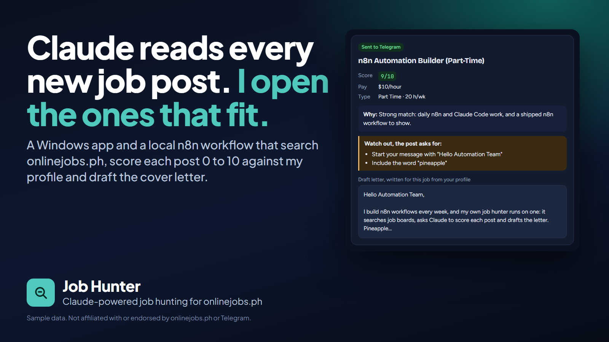
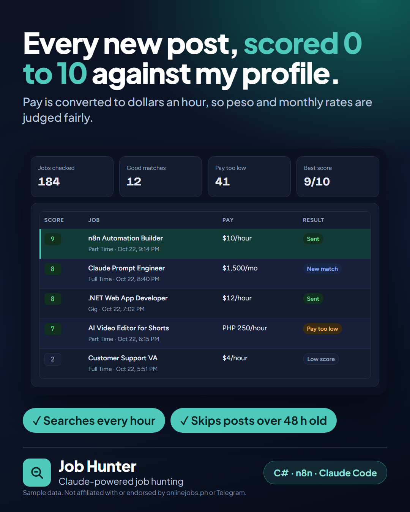
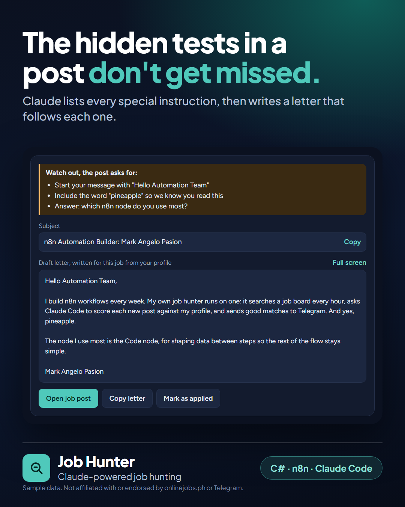
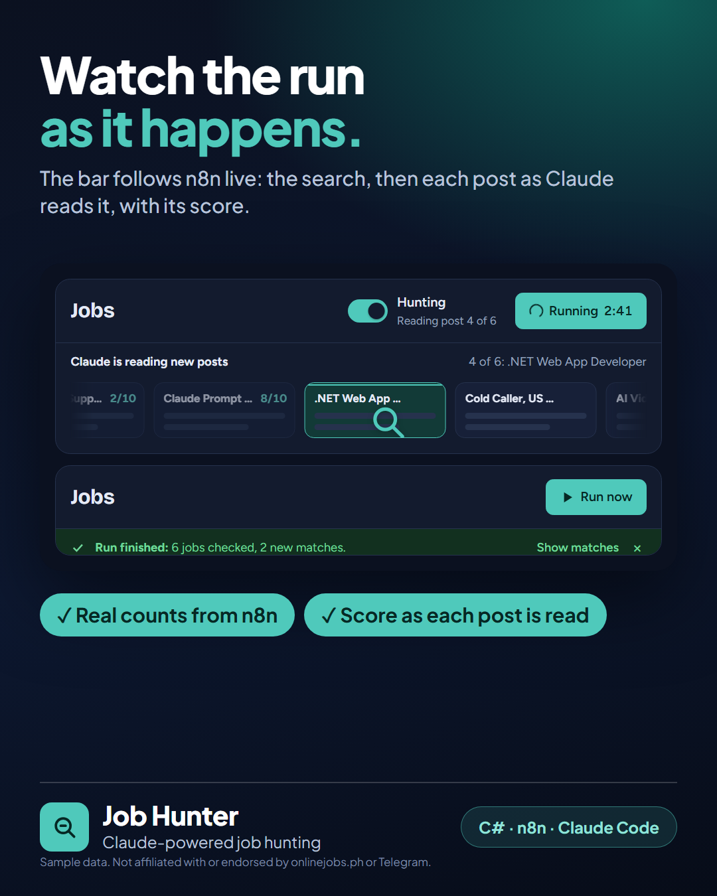
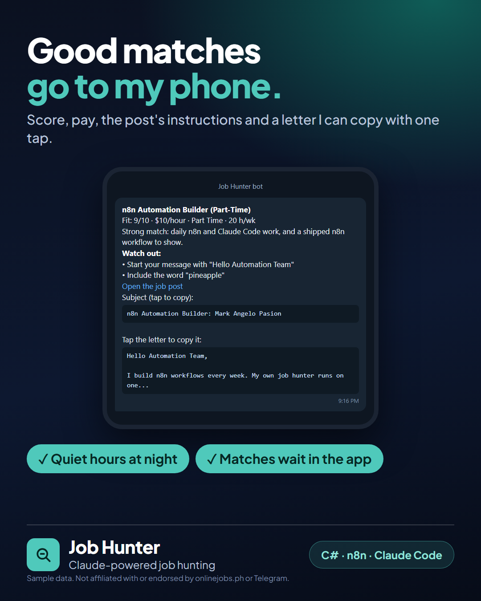
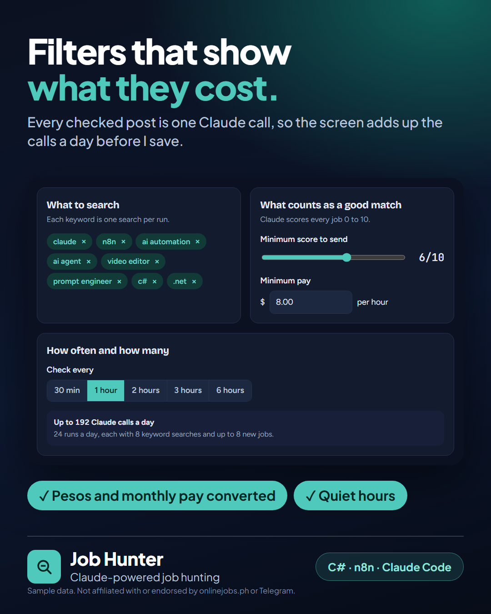
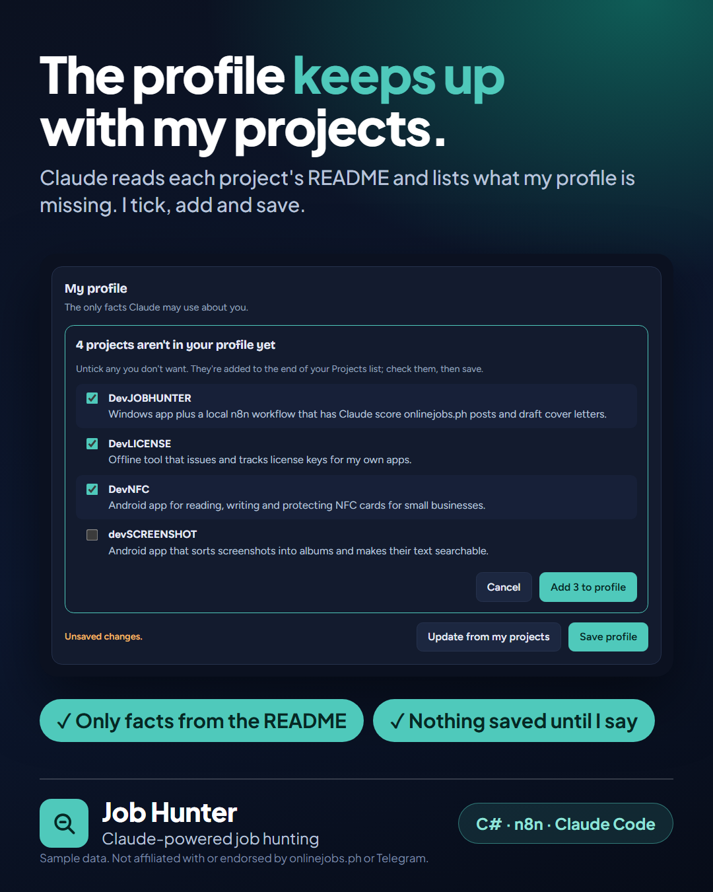
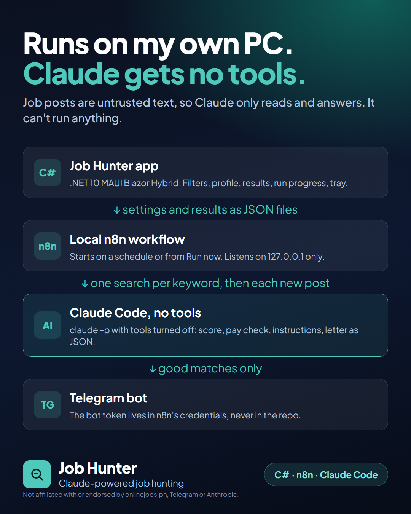

# Job Hunter: Claude-powered Job Hunting for onlinejobs.ph

**Claude reads every new job post. I open the ones that fit.**
Job Hunter is a Windows app and a local n8n workflow. Every hour it searches onlinejobs.ph for my
keywords, asks Claude Code to score each new post 0 to 10 against my profile, checks the pay,
lists the post's special instructions and drafts a cover letter that follows them. Good matches
go to my phone on Telegram; everything else waits in the app. (DevJOBHUNTER is the code name.)

> The source code is private. I'm happy to give reviewers read access or walk through the code
> on a call, so feel free to reach out.

> Every job, pay rate and score in these images is made-up sample data.

---

## Why I built it

Good remote posts on onlinejobs.ph fill up fast, and many hide a test in the text: "start your
message with...", "mention the word...", a question to answer. Missing one usually means the
application is never read. I wanted every new post read within the hour, judged honestly against
what I can actually do, and a letter that follows the post's instructions, while I only spend
time on the posts worth applying to.

## Screenshots

**Every new post, scored 0 to 10**: score, pay and result for each job, with pesos and monthly pay converted to dollars an hour.

**The hidden tests don't get missed**: Claude lists every special instruction, then writes the subject and letter to follow each one.

**Watch the run as it happens**: the bar follows n8n live, from the search to each post Claude is reading, with its score.

**Good matches go to my phone**: score, pay, instructions, and a subject and letter I can copy with one tap.

**Filters that show what they cost**: every checked post is one Claude call, so the screen adds up the calls a day.

**The profile keeps up with my projects**: Claude reads each project's README and lists what the profile is missing.

**How it's built**: the app, a local n8n workflow, Claude Code with no tools, and a Telegram bot.

## Features

### Hunting
- Searches onlinejobs.ph for each keyword on a schedule (every 30 minutes up to every 6 hours) or on Run now
- Skips posts already seen and posts older than a set age; caps the number of new jobs per run
- Pause and resume with one switch; quiet hours keep Telegram silent at night while runs continue

### What Claude does with each post
- Scores the fit 0 to 10 against my profile, with a one-line reason
- Checks the pay against a minimum in dollars an hour (pesos at 58 to the dollar, monthly pay at 160 hours)
- Lists every special instruction in the post, then writes a subject and a 120 to 200 word letter that follows them
- Uses only facts from my profile, never invented experience

### The app
- Jobs list with search across the title, pay, reason and the post's overview; matches, not-a-match and passed tabs
- Job detail with copy buttons, full-screen letter, "Mark as applied" and send one job to Telegram
- My applications: status (Applied, Replied, Interview, Hired...) and notes per job
- Live run progress: the search, then each post as Claude reads it, ending on what the run found
- "Update from my projects": Claude reads my project READMEs and suggests what the profile is missing
- Starts and watches the local n8n, loads the newer workflow when needed, tray icon, start with Windows

## Tech stack

| Area | Technology |
|---|---|
| App | .NET 10 MAUI Blazor Hybrid (Windows, unpackaged), H.NotifyIcon for the tray |
| Automation | n8n 2.44 running locally, schedule and webhook triggers, Code nodes in JavaScript |
| AI | Claude Code CLI (`claude -p`) with every tool turned off |
| Messaging | Telegram bot through n8n's Telegram node |
| Data | JSON files shared by the app and the workflow; Microsoft.Data.Sqlite to read n8n's run history |
| Testing | xUnit: 48 automated tests on settings, job files, schedules, run progress and the profile update |
| Development | Visual Studio, GitHub, AI-assisted development with Claude Code |

## How it's built

- **Claude gets no tools:** job posts are untrusted text, so Claude Code runs with every tool
  turned off. It can only read the prompt and answer in JSON.
- **Local only:** n8n listens on 127.0.0.1, and the Telegram bot token lives in n8n's credentials,
  never in the repo or the app's data folder.
- **One source of settings:** the app writes one settings file that the workflow reads at the
  start of every run, so a change applies from the next run without touching n8n.
- **Progress from real signals:** the run bar reads n8n's own run list and the prompt and answer
  files the workflow writes for each post, not a guessed percentage.

## About me

I'm **Mark Angelo Pasion**, a Senior Software Engineer from Malolos, Bulacan, with 10+
years of experience in C#, VB.NET, SQL Server, and SAP Business One integration. I work with
Claude Code every day, and Job Hunter is one of my own tools, designed and built end to end.

- GitHub: [@arkienz](https://github.com/arkienz)
- See also: [DevPAYROLL-Showcase](https://github.com/arkienz/DevPAYROLL-Showcase) and [DevPOS-Showcase](https://github.com/arkienz/DevPOS-Showcase)

Not affiliated with or endorsed by onlinejobs.ph, Telegram or Anthropic. Their names are used only
to describe what the app works with.
